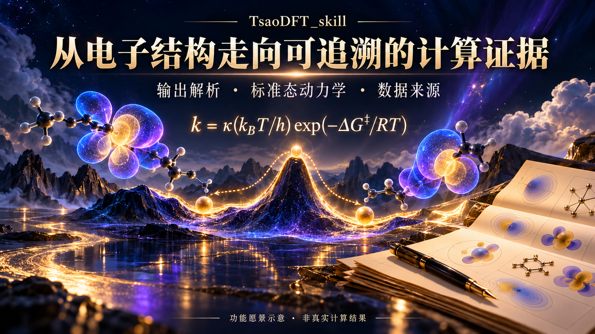

# TsaoDFT Skill

<p align="center">
  <strong>面向分子与周期体系的 DFT-first、数学化、证据锁定、可审计科研操作系统</strong><br>
  Python 科学控制面 + 可验证数值内核 + 外部专业引擎 + 机器可读资格边界
</p>

<p align="center">
  <a href="README.md">中文</a> · <a href="README_EN.md">English</a>
</p>

<p align="center">
  <a href="https://github.com/SUNHAOJUN22/TsaoDFT_skill/actions/workflows/ci.yml"></a>
  
  
  
  
  
  
</p>

> **AI图像声明｜AI-GENERATED CONCEPTUAL ILLUSTRATION：** 中文/英文 AI 愿景图、归档封面与 AI-assisted SVG 只表达系统结构、数理合同和使用策略。分子、晶格、轨道、能带、势能面、服务器与界面都不是 Gaussian、VASP、Quantum ESPRESSO、CP2K、Multiwfn、VMD 或实验产生的数据。所有技术图均标注 `SYNTHETIC DEMO · NOT SCIENTIFIC DATA`；定量结论只能来自通过验收的输入、输出、Parser、哈希与机器证据。

<!-- LOCALIZED_VISION_ZH:START -->
## 中文项目愿景图：从 Kohn–Sham 方程到材料与分子证据链

<p align="center">
  
</p>

> 图中公式用于解释代码中的方法身份、周期几何、Parser、SCF 与证据门；图不是电子密度、能带、轨道或真实 DFT 计算结果。

> 图中 Eyring 式是一分子基准示意；双分子或更高反应级数必须使用下文代码合同的标准浓度因子与势垒参考态。

<!-- LOCALIZED_VISION_ZH:END -->

<p align="center">
  <a href="assets/ai/hero/tsao-dft-hero.svg">英文归档图：系统总体愿景</a>
</p>


本页直接展示中文愿景图。历史英文技术示意图保留为标明语言的归档链接，原始文件、哈希与合成数据标记继续接受治理检查。

## 从代码出发：交付范围与推荐入口

TsaoDFT 将结构检查、周期日志解析、速率计算、机器学习基线和计算证据组织成独立 Python 工具。仓库提供可测试的软件合同、参考算法与交接文件；真实电子结构求解仍需要用户配置并运行 Gaussian、VASP、Quantum ESPRESSO 或 CP2K。愿景是让每一个数值都能回到输入、方法、最终作业和审核记录。

| 需求 | 实际入口 | 输出与适用边界 |
| --- | --- | --- |
| 结构与周期几何 | `skills/tsao-structure-prep/scripts/inspect_xyz.py` | 原子几何、邻居关系与算法等价；不计算电子密度 |
| 周期输出核验 | `skills/tsao-periodic-dft-materials/scripts/parse_qe.py`、`parse_vasp.py`、`parse_cp2k.py` | 最终作业的收敛、能量、版本、行号、字节偏移与完整文件 SHA-256 |
| Eyring 速率与区间 | `skills/tsao-dft-kinetics-multiscale/scripts/eyring_rates.py`、`propagate_barrier_uncertainty.py` | kcal/mol 势垒、K 温度；多分子反应必须提供标准浓度、势垒参考态与活度定义 |
| Ridge 基线 | `skills/tsao-dft-ml-active-learning/scripts/train_ridge_baseline.py` | 固定分组划分、输入与划分哈希、预测和模型卡；训练完成为 `training_completed` / `UNQUALIFIED` |
| 科学资格与交付 | `scripts/quality_gate.py` | 真实执行门禁回执；软件通过不等于外部引擎或科学结论已验收 |

### 安装并运行软件门禁

当前最低 Python 版本为 **3.11**，CI 矩阵为 3.11 / 3.12 / 3.13。2026-10-21 的依赖安全审计要求 Pillow 13.0.0（修复旧 12.3.0 中的八项漏洞），上游仅支持 Python >=3.11，因此不再声明 Python 3.10 兼容。升级时创建新环境，再安装对应 `constraints/py311.txt`、`py312.txt` 或 `py313.txt`；请勿复用旧3.10环境。certifi 同时升级至2026.10.19。来源：[Pillow 13.0.0](https://pypi.org/project/Pillow/13.0.0/)、[certifi安全公告](https://github.com/advisories/GHSA-6q48-6c7w-9gw2)。

推荐在 Python 3.12 独立环境安装已约束依赖。验收报告置于源码目录外，避免把不同机器产生的运行回执混进源码。

```bash
python3.12 -m venv .venv
. .venv/bin/activate
python -m pip install -c constraints/py312.txt -r requirements-dev.txt
python -m pip check
python scripts/run_all_tests.py
python scripts/quality_gate.py --report-dir ../tsao-dft-acceptance
```

跨七仓执行方案见 [完整并行修改与六小时验收 Prompt](docs/SEVEN_REPOSITORY_ACCEPTANCE_PROMPT.md)。执行器分别累计两个 10,800 秒的成功测试进程时间，完整验证后才可称六小时分段回归完成；安装、排队、等待与失败运行均不计入。该定义不等于六小时连续服务稳定性测试。

### 多分子速率：参考态属于输入合同

对 $m$ 分子基元步骤，浓度数值按 mol/L 计，且使用 $a=c/c^\circ$：

$$
k_m=\kappa g\frac{k_B T}{h}\exp\left(-\frac{\Delta G^\ddagger_{c^\circ}}{RT}\right)(c^\circ)^{1-m},
\qquad [k_m]=\mathrm{M}^{1-m}\mathrm{s}^{-1}.
$$

程序在对数域计算 $\ln k_m=\ln\kappa+\ln g+\ln(k_BT/h)-\Delta G^\ddagger/(RT)+(1-m)\ln c^\circ$。`standard_state` 与 `barrier_standard_state` 必须一致；不一致时拒绝计算，由研究者先完成有依据的自由能参考态换算。1 M 改为 0.1 M 且保持相同**数值势垒**时，双分子速率因子增大十倍；这只是浓度因子的回归检验，不能当作同一物理体系换参考态后速率改变的结论。

```bash
python skills/tsao-dft-kinetics-multiscale/scripts/eyring_rates.py \
  skills/tsao-dft-kinetics-multiscale/examples/catalysis/barriers.csv --temperature 298.15 --out ../rates.csv
python skills/tsao-dft-kinetics-multiscale/scripts/propagate_barrier_uncertainty.py \
  --barrier 15 --uncertainty 1 --temperature 298.15 --molecularity 2 \
  --standard-state '1 M' --barrier-standard-state '1 M' --activity-convention 'a=c/c0'
```

对声明的对称势垒界限 $u_G$，区间为 $k_{\min,\max}=\exp[\ln k_m\mp u_G/(RT)]$；它不包含泛函、溶剂、传质或路径选择的不确定度。极小速率可数值下溢为零，JSON 同时保留对应对数速率；溢出与非有限输入被拒绝。

### 周期日志：只接受最后一个作业的数值

```bash
python skills/tsao-periodic-dft-materials/scripts/parse_qe.py pw.out
python skills/tsao-periodic-dft-materials/scripts/parse_vasp.py OUTCAR
python skills/tsao-periodic-dft-materials/scripts/parse_cp2k.py cp2k.out
```

三个入口共享逐行有界读取器。每行最多 1 MiB，文件最多 1 GiB，最多 10,000 个作业；超出界限会明确失败。新作业重置版本、能量和收敛状态，后一个空作业不会继承前一个能量。`source_complete=false` 时哈希仅覆盖已消费的字节，结果不得用于完整工件验收。`NaN`、`Inf`、非零字面量转为零、单位换算溢出均拒绝，合法有限的小数仍保留。所有通过解析的结果继续保持 `scientific_acceptance=PENDING`。

### 机器学习：训练完成与科学批准分别记录

已有 `split` 列时仅接受 `train`、`valid`、`test`，同一 `parent_id` 不得跨组；没有该列时才采用固定种子的分组划分。训练特征不得包含目标或分组标识。模型卡记录原始 CSV 的 SHA-256、分组划分哈希及显式的 `UNQUALIFIED` 状态。

```bash
python skills/tsao-dft-ml-active-learning/scripts/train_ridge_baseline.py dataset.csv \
  --features descriptor_a,descriptor_b --target energy_eV --group parent_id \
  --out-dir ../ridge-baseline
```

可选 `--validation-artifact validation.json` 进一步要求校验报告 schema、数据集哈希、行数、划分哈希和方法指纹与本次训练一致。报告身份核验不会自动完成独立科学审核。模型误差必须按固定测试集报告，分组隔离后才可讨论泛化；ensemble 方差或 OOD 指标不替代误差校准。

## 验收状态与修改规范

- 静态预检状态为 `SOFTWARE_PREFLIGHT_READY`；旧 `SOFTWARE_ACCEPTANCE_READY` 不再作为已执行验收依据。当前运行须另有 `quality-run-acceptance.json` 的 `SOFTWARE_GATES_PASSED`，且最终 CI 必需作业全部成功；
- Gaussian、VASP、QE、CP2K 的真实正确性与性能：`EXTERNAL_HOLD`；
- 机器验收：`python scripts/build_release_acceptance.py --out release-acceptance.json --json`；
- 本轮自动改造 Prompt：[`docs/ACCEPTANCE_REWRITE_PROMPT.md`](docs/ACCEPTANCE_REWRITE_PROMPT.md)；
- 加速最高原则：[`docs/ACCELERATION_ENGINEERING_DOCTRINE.md`](docs/ACCELERATION_ENGINEERING_DOCTRINE.md)。

```bash
python scripts/capture_compute_contract_evidence.py --out compute-contract-evidence.json --json
python scripts/build_release_acceptance.py --out release-acceptance.json --json
python scripts/quality_gate.py
```

## 最高工程原则

1. **Python 是科学控制面。** 它负责工作流、Schema、方法指纹、调度、Parser、证据与报告，不应被整体 C++ 重写。
2. **专业 DFT 核心保持外部边界。** FFT、对角化、积分、SCF、MPI/OpenMP/GPU 内核由版本化的 Gaussian/VASP/QE/CP2K 构建承担。
3. **只迁移被 profiling 证明的窄热点。** CPU reference → NumPy/算法 → 可选 C++/OpenMP → 可选 CUDA/HIP/SYCL。
4. **任何新后端必须保留确定性参考、严格有限数值、失败回退和等价门。**
5. **技术感知不等于真实执行。** CUDA-X aware、GPU detected、job generated 都不是 speedup evidence。
6. **正确性资格先于性能资格。** 没有固定输入、真实引擎、许可证、build/site/run/hardware、科学容差与重复运行，就不得发布性能比。

<p align="center">
  <a href="assets/demo/workflow-architecture.svg">英文归档图：可审计科研闭环</a>
</p>

## 能力等级不是宣传标签

公开能力使用四级证据合同：

- `L0_REFERENCE`：参考资料、模板或方法说明；不宣称存在可执行适配器。
- `L1_HANDOFF`：生成结构化交接物，但执行与科学验收仍由下游工具完成。
- `L2_VALIDATED_ADAPTER`：适配器、Schema、严格输入边界和回归测试已经验证；它不等于已在真实授权专业软件、许可证和目标硬件上完成执行。
- `L3_EXECUTION_TESTED`：必须绑定真实 `engine/version/site/run_id` 与不可变 artifact SHA-256。HPC 或加速 L3 还必须绑定 build/hardware identity、CPU reference、至少三次重复、数值等价、Parser 验收、性能政策、内容寻址 evidence root 和独立签名审查。

当前仓库的 neighbor-list、逐行有界周期 Parser 与统一 mmap Parser、合同 validator 和 release acceptance 是永久门验证过的软件工件；它们不会自动把外部 Gaussian、VASP、QE 或 CP2K 提升为 `L3_EXECUTION_TESTED`。

## 数理核心：公式如何映射到代码合同

这些公式用于解释工作流、校验项和证据边界；它们不是仓库已经执行出的科学结果。

### 1. Kohn–Sham 方程与电子密度

$$
\hat H_{\mathrm{KS}}[\rho]\,\psi_i(\mathbf r)=\varepsilon_i\psi_i(\mathbf r),
\qquad
\rho(\mathbf r)=\sum_i f_i\lvert\psi_i(\mathbf r)\rvert^2.
$$

仓库对应策略：

- `method_fingerprint_id` 固定泛函、基组/赝势、色散、相对论、截断能与收敛参数；
- `observable_set` 明确能量、力、应力和附加性质；
- 不同引擎、不同赝势族或不同标准态不得静默合并。

### 2. 总能量泛函与自洽场固定点

$$
E[\rho]=T_s[\rho]+\int v_{\mathrm{ext}}(\mathbf r)\rho(\mathbf r)\,d\mathbf r
+E_H[\rho]+E_{\mathrm{xc}}[\rho]+E_{\mathrm{II}},
$$

$$
\rho^{(n+1)}=\mathcal F[\rho^{(n)}],
\qquad
R_n=\left\|\rho^{(n+1)}-\rho^{(n)}\right\|,
\qquad
R_n\le \tau_\rho.
$$

代码合同要求 `parser_accepted=true`、正常退出、收敛标志成立且所有数值有限；仅出现“正常结束字符串”不能覆盖后出现的 fatal marker。

数值读取还须区分真正的零与非零数下溢。设 $\operatorname{fl}(x)$ 为输入十进制数到运行时浮点数的转换，读取边界要求：

$$
\operatorname{isfinite}(\operatorname{fl}(x))
\quad\land\quad
\bigl(x=0\;\lor\;\operatorname{fl}(x)\ne0\bigr).
$$

Gaussian 公开解析器会对能量、频率、轨道和坐标等读取值执行这一检查；遇到溢出或非零下溢时返回 `parser_accepted=false`、`NUMERIC_RANGE_ERROR` 和非零退出码，并输出严格 JSON。基准证据、资格审查、EngineCapability、证据桥接和信任边界的 JSON 入口同时拒绝嵌套重复键、`NaN`、`Infinity` 与非零下溢；JSONL 每行沿用同一规则。基准证据、EngineCapability、证据桥接及资格政策的 YAML 入口也拒绝显式重复键、非有限数和非零下溢，保留合法 `<<` 合并、合并列表优先级及显式覆盖继承值。计算活动配置的 JSON/YAML 容差也不能把极小非零数静默变成零。真正的带符号零、可表示的次正规数和 JSON 大整数仍保留。遇到范围错误，应明确更换单位或数值表示；不要将输入手动改成零来获得通过。若调用方在序列化之前已经把非零数舍入为零，读取器无法恢复其原始精度。

统一 mmap 解析器还在 Hartree/Ry 到 eV、力和压力单位转换之后检查范围；有限的源值乘以换算因子，也可能溢出或下溢。异常力矢量行不能被静默跳过后伪装为完整数据。这些检查属于软件解析验收，`scientific_acceptance` 仍需独立科学审查。

引擎解析器 v1.2 只在最终 PWSCF 作业的最后一个完整 QE 力块包含已声明 `Ry/au` 单位、原子数以及恰好一次的 `1..N` 原子索引和三分量行时，才输出按原子 `x,y,z` 展平的 `3N` 力数组；换算使用项目固定的 CODATA 2018 Ry 与 Bohr 常数。该形状是 benchmark bridge 的扁平存储格式，不自动满足要求 `N×3` 形状和精确 `atom_mapping` 的 `TypedQuantity` 合同。QE `Total force` 是标量范数，`P=` 是标量压力；CP2K `Max. gradient` 也是标量。它们不会被伪装成力向量或应力张量；缺失、未知单位或不完整数据保留为 `null` 并告警，原始输出仍由 artifact 哈希留证。`parser_accepted` 的终止/SCF 门不保证所有科学观测量齐全。实现见 [`engine_parser_contract.py`](skills/tsao-dft-hpc-provenance/scripts/engine_parser_contract.py)。

基准桥接只接受与实际输出绑定的解析结果：`parser_result.engine` 必须匹配桥接引擎，`source_artifact.sha256` 必须匹配桥接时读取的输出文件；若解析结果还提供 `size_bytes`，也必须与文件大小一致。绑定失败会将解析接受状态置为 false，并把原因记录在 `evidence_source.missing_fields`。这些字段只证明所解析的字节与所引用的输出文件一致，不证明由哪个可执行程序或 HPC 作业生成。执行退出码必须来自运行时记录或调度器指标：`runtime.exit_status` 优先，缺失时回退到 `scheduler_metrics.exit_status`；两者都存在时必须相同。缺失、无效或冲突时，`execution.exit_status` 使用 `-1` 表示未知，并记录原因；不会从输出中的正常终止标记推断为零退出。解析器接受与进程成功分开，性能证据还要求退出码为零。

### 3. 力、应力与几何验收

$$
\mathbf F_I=-\frac{\partial E}{\partial \mathbf R_I},
\qquad
\sigma_{\alpha\beta}=\frac{1}{\Omega}\frac{\partial E}{\partial\epsilon_{\alpha\beta}}.
$$

使用策略：优化任务必须同时检查梯度、位移、频率或约束条件；过渡态不能仅凭优化收敛，必须结合一个虚频、IRC 或等价反应路径证据。

### 4. 周期体系、平面波与 Brillouin 区积分

$$
A=\frac{1}{\Omega_{\mathrm{BZ}}}\int_{\mathrm{BZ}}A(\mathbf k)\,d\mathbf k
\approx \sum_{\mathbf k}w_{\mathbf k}A(\mathbf k),
$$

$$
\frac{\lvert\mathbf k+\mathbf G\rvert^2}{2}\le E_{\mathrm{cut}}.
$$

策略上必须保持 k 点、截断能、smearing、赝势、磁性与超胞身份可追踪；能带/DOS 与总能量收敛应分别验收。

### 5. 周期 minimum-image 与 cell-list

代码采用 NumPy **行向量**约定：晶格基矢是 $\mathbf H$ 的行，笛卡尔位移满足 $\Delta\mathbf r=\Delta\mathbf s\mathbf H$。对任意三斜胞，逐分量 `round()` 只在正交盒等特殊情形保证最近周期像；通用定义必须在启用周期轴集合 $\mathcal P$ 上求最近格点：

$$
\mathbf n^\star=
\operatorname*{arg\,min}_{\mathbf n\in\mathbb Z_{\mathcal P}}
\left\|\Delta\mathbf r-\mathbf n\mathbf H\right\|_2,
\qquad
\Delta\mathbf r_{\mathrm{MIC}}
=\Delta\mathbf r-\mathbf n^\star\mathbf H.
$$

对于正交盒，上式退化为快速路径：

$$
\Delta\mathbf s_{\mathrm{MIC}}
=\Delta\mathbf s-\operatorname{round}_{\mathcal P}(\Delta\mathbf s),
\qquad
\Delta\mathbf r_{\mathrm{MIC}}
=\Delta\mathbf s_{\mathrm{MIC}}\mathbf H,
\qquad
d_{ij}=\lVert\Delta\mathbf r_{\mathrm{MIC}}\rVert_2.
$$

`neighbor_list.py` 对倾斜晶胞使用有界最近格点枚举，并以 `MAX_MINIMUM_IMAGE_CANDIDATES` 对病态晶胞实施资源上限；超过上限时失败关闭，而不是退回可能错误的逐分量舍入。全对参考复杂度为 $O(N^2)$；有限密度和固定 cutoff 下，cell-list 的平均候选复杂度接近：

$$
O\!\left(N+N\,\bar n_{\mathrm{cell}}\right),
$$

其中 $\bar n_{\mathrm{cell}}$ 是局部相邻网格候选数。`reference`、`numpy`、`cell-list` 必须返回相同、确定性排序的 pair 集合。

### 6. 数值等价、容差与性能资格

$$
\lvert x-x_{\mathrm{ref}}\rvert
\le a_{\mathrm{tol}}+r_{\mathrm{tol}}\lvert x_{\mathrm{ref}}\rvert,
$$

$$
S=\frac{\operatorname{median}(t_{\mathrm{reference}})}
        {\operatorname{median}(t_{\mathrm{candidate}})},
\qquad n_{\mathrm{repeat}}\ge 3.
$$

只有 input/method/build/hardware/site 身份稳定、run_id 唯一、Parser 接受、artifact 全部 `VERIFIED`、科学量等价后，$S$ 才允许进入 scoped review。否则保持 `EXTERNAL_HOLD`。

### 7. 反应动力学与详细平衡

$$
k(T)=\kappa\frac{k_{\mathrm B}T}{h}\exp\!\left(-\frac{\Delta G^\ddagger}{RT}\right),
$$

$$
\frac{k_f}{k_r}=\exp\!\left(-\frac{\Delta G_{\mathrm{rxn}}}{RT}\right).
$$

单分子式对应 $m=1$、$g=1$。多分子步骤使用上文的浓度因子与势垒参考态合同。正逆速率比仅在一致的活度、标准态与配分定义下连接热力学平衡常数；浓度速率常数的比值还须包含相应标准浓度幂。CLI 验证输入合同，不能替用户证明热化学数据的科学有效性。

### 8. ML 不确定度与 OOD 门

对 ensemble 预测 $\{\hat y_m(\mathbf x)\}$：

$$
\bar y(\mathbf x)=\frac1M\sum_{m=1}^M\hat y_m(\mathbf x),
\qquad
u^2(\mathbf x)=\frac1{M-1}\sum_{m=1}^M\left(\hat y_m-\bar y\right)^2.
$$

当 $u(\mathbf x)>u_{\max}$ 或 OOD score 超阈值时，使用策略应暂停预测并交接真实 DFT 验证；该条件是工作流门，基线脚本不会自动启动远程求解器。

<p align="center">
  <a href="assets/demo/dft-mathematical-core.svg">英文归档图：DFT 数学核心与代码映射</a>
</p>

<p align="center">
  <a href="assets/demo/qualification-mathematics.svg">英文归档图：数值等价与性能资格</a>
</p>

## 八个 Skills，一条证据链

| Skill | 主要职责 | 验收边界 |
|---|---|---|
| [`tsao-dft-suite`](skills/tsao-dft-suite/) | DFT-first 总入口、DAG、审批和跨 Skill 路由 | 只协调，不替代引擎科学判断 |
| [`tsao-structure-prep`](skills/tsao-structure-prep/) | 分子、晶体、表面、缺陷、吸附、原子映射、邻居搜索 | 不静默决定电荷、自旋、氧化态、终止面或质子化 |
| [`tsao-dft-researcher`](skills/tsao-dft-researcher/) | Gaussian DFT/TDDFT、Opt/Freq、TS/IRC、热化学、NMR、Multiwfn、VMD | 用户提供真实程序、许可证和执行环境 |
| [`tsao-periodic-dft-materials`](skills/tsao-periodic-dft-materials/) | VASP、QE、CP2K、表面/缺陷、能带/DOS、NEB、收敛 | 不混用不兼容能量和赝势身份 |
| [`tsao-dft-ml-active-learning`](skills/tsao-dft-ml-active-learning/) | 标签审计、数据泄漏、适用域、不确定度、主动学习 | 高分数不等于机理或因果证据 |
| [`tsao-dft-kinetics-multiscale`](skills/tsao-dft-kinetics-multiscale/) | Eyring/TST、反应网络、详细平衡、误差传播 | 只消费验收过的标准态与热化学数据 |
| [`tsao-dft-hpc-provenance`](skills/tsao-dft-hpc-provenance/) | Windows/POSIX、Slurm/PBS、硬件盘点、Parser、benchmark、签名证据 | GPU 分配或最快单次不是真实 speedup |
| [`tsao-dft-catalysis-profile`](skills/tsao-dft-catalysis-profile/) | 催化与聚合物专用 Profile | 不自动外推到无关体系 |

## 可执行使用策略

### 策略 A：结构准备与邻居搜索

```bash
python skills/tsao-structure-prep/scripts/inspect_xyz.py structure.xyz \
  --backend reference --json
python skills/tsao-structure-prep/scripts/inspect_xyz.py structure.xyz \
  --backend numpy --json
python skills/tsao-structure-prep/scripts/inspect_xyz.py periodic.xyz \
  --backend cell-list --periodic xyz \
  --box 10 0 0 0 10 0 0 0 10 --json
```

先用 `reference` 建立小体系真值，再用 `numpy`/`cell-list` 做等价和候选缩减；`evaluated_pair_count` 不是 DFT speedup。

### 策略 B：统一 Parser 与工件哈希

```bash
python skills/tsao-dft-hpc-provenance/scripts/engine_parser_contract.py \
  --engine gaussian --input job.log --json
python skills/tsao-dft-hpc-provenance/scripts/engine_parser_contract.py \
  --engine vasp --input OUTCAR --json
```

Parser 使用只读 mmap、bounded scan 和映射工件 SHA-256；fatal marker 优先级高于较早的成功标记。

### 策略 C：Gaussian 分子工作流

1. 锁定电荷、多重度、溶剂、泛函、基组、色散与积分网格；
2. Preflight 后再执行 Opt/Freq；
3. 极小值要求无虚频，TS 通常要求一个目标虚频并由 IRC/路径证据支持；
4. 波函数/ESP/Multiwfn/VMD 图件必须保留源工件哈希。

### 策略 D：VASP / QE / CP2K 周期工作流

1. 先做 cutoff、k 点、smearing、磁性、超胞和赝势收敛；
2. 再执行结构、能带/DOS、缺陷、表面、NEB 或声子；
3. GPU 路线只接受对应版本的官方 GPU 构建与完整 build/hardware/site/run identity；
4. 不同 engine/build/site 不得合并成一个 speedup campaign。

### 策略 E：HPC 与 Windows/Linux

```bash
python skills/tsao-dft-hpc-provenance/scripts/generate_job_script.py \
  --shell bash --scheduler slurm --json
pwsh -NoProfile -File .\scripts\quality_gate.ps1
```

外部程序一律通过 structured argv、版本化 JSON、输入/输出文件、return code 和 content hash 交接，不拼接不受控 shell 字符串。

### 策略 F：资格证据

```bash
python scripts/validate_benchmark_contract.py --json
python scripts/validate_compute_qualification.py --json
python scripts/capture_compute_contract_evidence.py --out compute-contract-evidence.json --json
python scripts/build_release_acceptance.py --out release-acceptance.json --json
```

<p align="center">
  <a href="assets/demo/evidence-qualification-pipeline.svg">英文归档图：证据资格流程</a>
</p>

<p align="center">
  <a href="assets/demo/scientific-acceleration-funnel.svg">英文归档图：科学加速资格流程</a>
</p>

## 已实现的软件加速层

| 层 | 状态 | 实现 | 非主张 |
|---|---|---|---|
| Python 科学控制面 | 已实现 | Schema、DAG、argv、Parser、evidence | 不是电子结构数值核 |
| CPU reference | 已实现 | 标量、NumPy、BLAS/LAPACK | 不自动等于最优性能 |
| neighbor-list | 已实现 | reference / NumPy / cell-list | 不构成外部 DFT speedup |
| mmap Parser | 已实现 | read-only mmap、bytes regex、SHA-256 | 不加速 SCF/FFT/对角化 |
| C++/OpenMP sidecar | 未建立 | profile-gated | 不得写成已完成 |
| CUDA/HIP/SYCL | 未建立 | optional device plugins | 不得因 GPU 存在自动启用 |
| 外部引擎性能 | `EXTERNAL_HOLD` | 官方 engine GPU/MPI build | 未发布加速比 |

<p align="center">
  <a href="assets/demo/hybrid-compute-architecture.svg">英文归档图：混合计算架构</a>
</p>

<table>
<tr>
<td width="50%"><a href="assets/demo/cuda-x-decision-map.svg">英文归档图：CUDA-X 路径选择</a></td>
<td width="50%"><a href="assets/demo/acceleration-registry-governance.svg">英文归档图：加速注册表治理</a></td>
</tr>
<tr>
<td><a href="assets/demo/backend-portability-stack.svg">英文归档图：后端可移植性</a></td>
<td><a href="assets/demo/native-acceleration-roadmap.svg">英文归档图：原生加速路线</a></td>
</tr>
</table>

## Windows、Linux 与外部引擎边界

- VASP：只认可对应版本的官方 OpenACC/GPU 构建、CUDA-aware MPI、GPU/rank 绑定与 build fingerprint；
- Quantum ESPRESSO：记录版本、编译器、GPU 支持、MPI、pool/task-group 与对角化路径；
- CP2K：记录官方 CUDA/HIP/OpenCL 构建能力和真实执行身份；
- Gaussian：仓库负责预检、Parser、批处理与证据，除非产品明确支持，否则不声称电子结构核心加速。

<p align="center">
  <a href="assets/demo/windows-linux-execution-matrix.svg">英文归档图：Windows 与 Linux 执行矩阵</a>
</p>

## ML、动力学与边缘闭环

```text
结构与条件
→ 已验收 surrogate
→ uncertainty / OOD gate
→ 安全域内推理
→ 域外远程真实 DFT
→ 结果回流受治理数据集
```

<table>
<tr>
<td width="50%"><a href="assets/demo/dft-ml-dashboard.svg">英文归档图：DFT 与机器学习合同</a></td>
<td width="50%"><a href="assets/demo/edge-hpc-closed-loop.svg">英文归档图：边缘与 HPC 闭环</a></td>
</tr>
<tr>
<td><a href="assets/demo/multiscale-kinetics.svg">英文归档图：多尺度动力学交接</a></td>
<td><a href="assets/demo/periodic-dft-materials.svg">英文归档图：周期 DFT 证据链</a></td>
</tr>
</table>

## 科研图件治理

下列图件均为合成示意，不是生产计算结果：

<table>
<tr>
<td width="50%"><a href="assets/demo/wavefunction-esp-gallery.svg">英文归档图：波函数与静电势图件合同</a></td>
<td><a href="assets/demo/scientific-acceleration-funnel.svg">英文归档图：科学加速资格流程</a></td>
</tr>
</table>

视觉规范见 [`docs/README_VISUAL_DESIGN_SYSTEM.md`](docs/README_VISUAL_DESIGN_SYSTEM.md)，AI 图治理见 [`docs/AI_IMAGE_GOVERNANCE.md`](docs/AI_IMAGE_GOVERNANCE.md)。

## 安装、验证与验收

```bash
python scripts/install.py --agent codex --scope project --skill all --dry-run --validate
python scripts/validate_readme_math.py --json
python scripts/quality_gate.py
```

PowerShell：

```powershell
pwsh -NoProfile -File .\scripts\quality_gate.ps1
```

永久 CI 必须通过：Python 3.11、3.12、3.13、Windows PowerShell、dependency audit + CycloneDX SBOM、CodeQL 和全部 29/29 repository quality stages。历史基线为 630 tests / 9 suites；当前测试数量与结论以当前提交的实际运行记录为准。

静态预检只验证仓库合同，不能证明本次测试通过；实际软件验收必须查阅当前提交的质量回执和 CI。外部 DFT 引擎执行与加速资格继续为 `EXTERNAL_HOLD`。

---

**TsaoDFT 的目标不是让每个文件看起来更底层，而是让每个公式、参数、计算、图件、性能结论和工程迁移都有可复核的证据边界。**

<!-- CURRENT_MAIN_ACCEPTANCE_V2:START -->
## 当前 `main`：代码—数学—证据闭环

<p align="center"></p>

> 该图由当前代码合同生成，是概念设计，不是电子结构运行数据。

### 核心数理合同

$$
\left[-\frac{1}{2}\nabla^2+V_{\mathrm{eff}}[n]\right]\psi_i=\varepsilon_i\psi_i
$$

$$
\mathbf n^\star=\operatorname*{arg\,min}_{\mathbf n\in\mathbb Z_{\mathcal P}}\lVert(\mathbf s-\mathbf n)\mathbf H\rVert_2
$$

$$
|\Delta E|\le\tau_E\quad\land\quad\max_i\lVert\Delta\mathbf F_i\rVert_2\le\tau_F
$$

### 使用策略

1. 先冻结结构、晶胞、周期性和单位，再生成引擎输入。
2. SCF、能量、力和应力只有在有限、收敛且方法身份完整时才可验收。
3. 探测、模板与解析器结果不得升级为真实 DFT 计算证据。
4. 任何新提交都会使旧 SHA 的六小时软件证据失效。

> **责任边界：** 软件门禁只验证控制面、参考数值与证据合同；Gaussian、VASP、QE、CP2K 等外部引擎未在此自动执行，保持 EXTERNAL_HOLD。

执行提示词: [SIX_REPOSITORY_PARALLEL_6H_ACCEPTANCE_PROMPT_V2.md](docs/SIX_REPOSITORY_PARALLEL_6H_ACCEPTANCE_PROMPT_V2.md)
<!-- CURRENT_MAIN_ACCEPTANCE_V2:END -->
