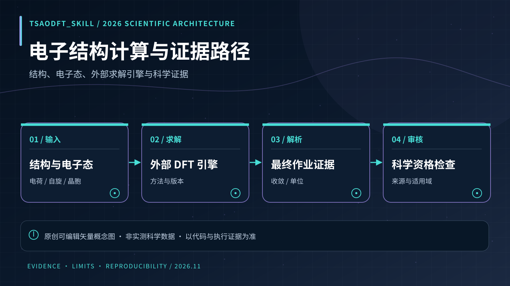
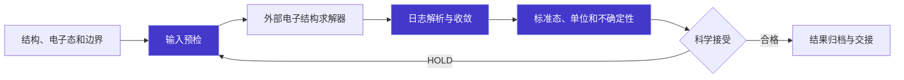

# TsaoDFT Skill

**把分子、晶体与反应问题组织成可核验的计算证据。** 本仓库提供 Python 科学控制面、确定性参考算法、输入检查、输出解析、动力学和机器学习基线，以及受约束的执行与证据交接。电子结构求解由用户配置的 Gaussian、VASP、Quantum ESPRESSO、CP2K 等专业引擎承担。

[English](README_EN.md) · [八个 Skill 的目录](skills/) · [引擎支持矩阵](docs/ENGINE_SUPPORT_MATRIX.md) · [架构](docs/ARCHITECTURE.md) · [MIT 许可证](LICENSE)


**AI图像声明 — AI-GENERATED CONCEPTUAL ILLUSTRATION。** 上图使用原创 AI 艺术背景和按代码核对的中文、公式轮廓路径；图中结构、光场及表面是合成概念，不是轨道、电子密度、实验测量或真实引擎计算结果。公式解释的是适用条件明确的软件算法。[图像来源与 SHA-256](docs/assets/readme-vnext/artwork-provenance.json)与受控图件验证一起维护，旧图在文末保留归档链接。

## 科学计算架构：可编辑矢量图



该图是重新绘制的方法学示意，不代表真实求解、实测数据或工业认证。所有技术结论以代码、运行日志和适用条件为准。

## DFT 研究的资格门



**图示仅为方法学流程，不是计算轨道或真实能量面。** 原始 DFT 执行需记录引擎版本、输入、赝势/基组、收敛条件、原始输出及摘要。仓库中的合成测试数据验证的是软件入口行为，不赋予外部求解的科学资格。

## 交付范围与状态

当前软件版本由 [pyproject.toml](pyproject.toml) 声明为 `0.4.0a2`，最低 Python 版本为 **3.11**。项目对“准备完成、运行结束、解析通过、科学接受”分别记录；这一区分也适用于示例、图件和模型卡。

| 能力 | 可执行实现 | 产物与边界 |
|---|---|---|
| 分子和周期几何检查 | [inspect_xyz.py](skills/tsao-structure-prep/scripts/inspect_xyz.py)、[neighbor_list.py](skills/tsao-structure-prep/scripts/neighbor_list.py) | 接触、距离、确定性邻居对；XYZ 不足以推断电荷、多重度或化学合理性 |
| 分子输入与输出 | [preflight_gaussian_input.py](skills/tsao-dft-researcher/scripts/preflight_gaussian_input.py)、[parse_gaussian.py](skills/tsao-dft-researcher/scripts/parse_gaussian.py) | 方法、终止、最终作业、频率/轨道等可观察记录；TS 和机理仍需独立审核 |
| 周期输入与输出 | [周期脚本](skills/tsao-periodic-dft-materials/scripts/) | VASP/QE/CP2K 预检、最终作业解析、收敛系列；原始引擎和赝势不在仓库中 |
| 反应速率与区间 | [eyring_rates.py](skills/tsao-dft-kinetics-multiscale/scripts/eyring_rates.py)、[propagate_barrier_uncertainty.py](skills/tsao-dft-kinetics-multiscale/scripts/propagate_barrier_uncertainty.py) | 显式标准态的 Eyring 参考速率、给定势垒界限的传播；不自动验证机理 |
| 数据与 Ridge 基线 | [train_ridge_baseline.py](skills/tsao-dft-ml-active-learning/scripts/train_ridge_baseline.py) | 分组隔离、训练集标准化、primal/dual 求解、预测表、模型卡；训练成功保持 `UNQUALIFIED` |
| 执行与科学证据 | [HPC/provenance](skills/tsao-dft-hpc-provenance/)、[build_release_acceptance.py](scripts/build_release_acceptance.py) | structured argv、输入身份、哈希、签名审查和资格报告；没有真实运行记录就没有外部执行资格 |

`SOFTWARE_PREFLIGHT_READY` 表示静态交付预检就绪。旧标签 `SOFTWARE_ACCEPTANCE_READY` 不构成已运行门禁的证据。只有完整运行生成的 `quality-run-acceptance.json` 才能记录 `SOFTWARE_GATES_PASSED`；它仍只覆盖该门禁进程，其他 CI 作业必须各自成功。真实外部 DFT 正确性、站点性能和科学结论在证据不足时保持 **`EXTERNAL_HOLD`**。

## 安装与第一次运行

从仓库根目录执行。Linux/macOS 示例使用 Python 3.12；Python 3.11/3.13 分别使用对应的 `constraints/py311.txt` / `constraints/py313.txt`。运行时依赖与开发工具由 [requirements-dev.txt](requirements-dev.txt) 和约束文件管理；不需要安装外部 DFT 引擎即可运行软件回归。

```bash
python3.12 -m venv .venv
. .venv/bin/activate
python -m pip install -c constraints/py312.txt -r requirements-dev.txt
python -m pip check
```

下面的随仓示例都是 **SYNTHETIC DEMO / NOT SCIENTIFIC DATA**。输出放到仓库外的 `../tsao-dft-demo`；更改路径时不要指向原始输入。以新的目录保存每次科学运行，保留源字节、环境和方法身份。

### 1. 检查结构，再决定方法

```bash
python skills/tsao-structure-prep/scripts/inspect_xyz.py \
  skills/tsao-structure-prep/examples/geometry-audit/water.xyz \
  --backend cell-list --json
```

几何文件长度单位为 Å。`--box` 的九个数按晶格行向量排列，`--periodic` 显式声明周期轴。`auto` 根据规模选择参考/NumPy/cell-list 路径；不同后端必须返回相同的确定性邻居对。半径推断的键是几何启发式，不能作为自动修正价态或质子化的依据。

### 2. 预检分子输入与周期输出

```bash
python skills/tsao-dft-researcher/scripts/preflight_gaussian_input.py \
  skills/tsao-dft-researcher/tests/fixtures/preflight.gjf --json
```

```bash
python skills/tsao-periodic-dft-materials/scripts/preflight_vasp.py \
  skills/tsao-periodic-dft-materials/examples/engine-adapters/vasp --json
python skills/tsao-periodic-dft-materials/scripts/parse_vasp.py \
  skills/tsao-periodic-dft-materials/examples/engine-adapters/vasp/OUTCAR
```

上面读取的是合成输入与合成日志，没有启动 Gaussian/VASP。真实 Gaussian 日志使用 `parse_gaussian.py` 的位置参数和 `--json`；QE/CP2K 分别使用 `parse_qe.py`、`parse_cp2k.py` 的输出文件位置参数。共享 [engine_parser_contract.py](skills/tsao-dft-hpc-provenance/scripts/engine_parser_contract.py) 是 Python 导入 API，**没有 `--engine gaussian` 命令行入口**，不能把“执行后无输出”当作解析成功。

周期公开解析器逐行有界读取：每行最多 1 MiB、文件最多 1 GiB、最多 10,000 个作业。最终作业开始时重置能量、版本和收敛字段；空尾作业不会借用前一作业的成功记录。`source_complete=false` 表示哈希只覆盖已消费字节，不能认证完整源工件。终止/SCF 通过也不保证全部性质齐全；`scientific_acceptance` 继续等待科学审核。

### 3. 计算声明标准态下的速率

```bash
python skills/tsao-dft-kinetics-multiscale/scripts/eyring_rates.py \
  skills/tsao-dft-kinetics-multiscale/examples/catalysis/barriers.csv \
  --temperature 298.15 --out ../tsao-dft-demo/rates.csv
```

```bash
python skills/tsao-dft-kinetics-multiscale/scripts/propagate_barrier_uncertainty.py \
  --barrier 15 --uncertainty 1 --temperature 298.15 --molecularity 2 \
  --standard-state '1 M' --barrier-standard-state '1 M' --activity-convention 'a=c/c0'
```

势垒与半宽用 kcal/mol，温度用 K；`kappa` 和路径简并度均须有限且为正。多分子反应必须给出一致的速率标准浓度、势垒参考浓度与活度约定。程序不会替用户完成不同标准态的自由能换算。CSV 头不能重复或为空，输出不能覆盖输入；失败时保留已有速率文件。

### 4. 核对不确定度来源

```bash
python skills/tsao-dft-researcher/scripts/validate_uncertainty_budget.py \
  skills/tsao-dft-researcher/templates/uncertainty-budget.yaml
```

模板选择 `report_separately`，因此不报告合成总误差。`root_sum_square` 与 `sum_bounds` 必须符合所声明的分量解释；任何无效分量或不可表示的合成值都使预算拒绝接受，`combined_magnitude=null`，不能留下看似有效的部分总量。

### 5. 训练独立分组的模型基线

```bash
python skills/tsao-dft-ml-active-learning/scripts/train_ridge_baseline.py \
  skills/tsao-dft-ml-active-learning/examples/dft-baseline/dataset.csv \
  --features descriptor_1,descriptor_2 --target target --group parent_id \
  --alpha 1 --solver auto --out-dir ../tsao-dft-demo/ridge
```

示例列 `target` 只是合成标签，没有科学单位。真实数据须在数据卡中记录性质、单位和方法指纹。存在 `split` 列时严格使用 `train`/`valid`/`test`，同一 `parent_id` 不得跨组；没有该列时才按固定随机种子对组划分。均值和尺度只由训练集计算，目标或组标识不能成为特征。重复表头、缺失文件或输出覆盖数据/验证报告都被明确拒绝。

`predictions.csv` 与 `model-card.json` 记录预测、分组哈希、原始数据 SHA-256 和标准化参数。`--validation-artifact` 可绑定已提供报告的 schema、样本数、分组哈希和方法身份；绑定通过仍不授予独立科学批准。主动学习脚本按不确定度排序、每组最多一个候选，不会自动运行远程 DFT。

## 数理核心：已实现算法与外部方法合同

### A. Kohn–Sham 方法身份：外部引擎合同

$$
\hat H_{\mathrm{KS}}[\rho]\psi_i(\mathbf r)=\varepsilon_i\psi_i(\mathbf r),
\qquad \rho(\mathbf r)=\sum_i f_i|\psi_i(\mathbf r)|^2.
$$

$$
E[\rho]=T_s[\rho]+\int v_{\mathrm{ext}}(\mathbf r)\rho(\mathbf r)\,d\mathbf r
+E_H[\rho]+E_{\mathrm{xc}}[\rho]+E_{\mathrm{II}}.
$$

这些是电子结构方法的定义，仓库没有实现 Kohn–Sham 求解器。轨道 $\psi_i$、占据 $f_i$、密度 $\rho$ 及能量泛函需由声明方法的真实外部引擎给出。[方法指纹校验](skills/tsao-dft-suite/scripts/validate_method_fingerprint.py)固定泛函、基组/赝势、色散、自旋、网格和容差，防止不同模型的数值静默混用。

$$
\mathbf F_I=-\frac{\partial E}{\partial\mathbf R_I},
\qquad A=\frac1{\Omega_{\mathrm{BZ}}}\int_{\mathrm{BZ}}A(\mathbf k)\,d\mathbf k
\approx\sum_{\mathbf k}w_{\mathbf k}A(\mathbf k).
$$

力是每个原子的三分量量；Brillouin 区权重按给定归一化约定记录。能量、力、压力和应力不能互换：QE 的 `Total force`、`P=` 以及 CP2K `Max. gradient` 是标量，解析器不会据此伪造力数组或应力张量。共享 QE 力块的展平 `3N` 存储格式也不能自动满足要求 `N×3` 与原子映射的 TypedQuantity 合同。

### B. 周期几何：行晶格、最近像与确定性配对

$$
\Delta\mathbf r=\Delta\mathbf s\mathbf H,\qquad
\mathbf n^\star=\operatorname*{arg\,min}_{\substack{\mathbf n\in\mathbb Z^3\\n_j=0\ (j\notin\mathcal P)}}
\|\Delta\mathbf r-\mathbf n\mathbf H\|_2,
\qquad\Delta\mathbf r_{\mathrm{MIC}}=\Delta\mathbf r-\mathbf n^\star\mathbf H.
$$

$\mathbf H$ 每一行是一个晶格向量，$\mathcal P$ 是启用的周期轴。一般斜晶胞采用有界最近格点搜索；逐分量舍入只作为正交晶胞的快路径：

$$
\Delta\mathbf s_{\mathrm{MIC}}=\Delta\mathbf s-\operatorname{round}_{\mathcal P}(\Delta\mathbf s),
\qquad\Delta\mathbf r_{\mathrm{MIC}}=\Delta\mathbf s_{\mathrm{MIC}}\mathbf H.
$$

[neighbor_list.py](skills/tsao-structure-prep/scripts/neighbor_list.py) 要求有限坐标、有效晶胞和正截断距离。`MAX_MINIMUM_IMAGE_CANDIDATES=100000` 是病态晶胞的安全上限；超限是拒绝，不是近似成功。返回的原子对确定性排序。全对参考为 $O(N^2)$；固定密度、固定截断且局部占据受控时 cell-list 平均候选量近似为：

$$
O\!\left(N+N\bar n_{\mathrm{cell}}\right).
$$

这个条件复杂度不构成实测提速；必须比较整个任务的准备、搜索、序列化和运行环境。

### C. Eyring 速率：先完成对数计算，再指数化

$$
k_m=\kappa g\frac{k_BT}{h}\exp\!\left(-\frac{\Delta G^\ddagger_{c^\circ}}{RT}\right)
(c^\circ)^{1-m},\qquad[k_m]=\mathrm M^{1-m}\mathrm s^{-1}.
$$

$$
\ln k_m=\ln\kappa+\ln g+\ln k_B+\ln T-\ln h
-\frac{\Delta G^\ddagger}{RT}+(1-m)\ln c^\circ.
$$

源码 [tst_math.py](skills/tsao-dft-kinetics-multiscale/scripts/tst_math.py) 使用 $k_B=1.380649\times10^{-23}$ J/K、$h=6.62607015\times10^{-34}$ J·s、$R=8.31446261815324/4184$ kcal/(mol·K)。对数作用于这些固定单位下的数值；$c^\circ$ 的数值以 mol/L 为单位。单分子 $m=1$ 得到 s⁻¹，多分子需要明确 $a=c/c^\circ$。改变标准浓度但保持数值势垒不变只检验浓度因子，不是同一物理体系的参考态变换。

$$
\ln k_{\min}=\ln k_m-\frac{u_G}{RT},\qquad
\ln k_{\max}=\ln k_m+\frac{u_G}{RT}.
$$

$u_G\ge0$ 是用户给定的对称势垒界限。速率和区间均先纳入浓度因子再指数化，避免可表示的最终结果被中间溢出拒绝。非有限输入和最终溢出被拒绝；极小速率可下溢为零，区间 JSON 保留有限对数速率。区间不是自动校准的置信区间，也不包含未量化的机理、溶剂或传质误差。极端浮点回归不能扩大 TST 的物理适用范围。

### D. 不确定度：声明规则，验证有限总量

$$
u_{\mathrm{RSS}}=\sqrt{\sum_i u_i^2},\qquad
u_{\mathrm{bound}}=\sum_i u_i.
$$

[不确定度预算校验](skills/tsao-dft-researcher/scripts/validate_uncertainty_budget.py) 分别使用稳定的 `math.hypot` 和补偿求和 `math.fsum`，并再次验证聚合结果有限。RSS 适合声明为独立、同单位标准不确定度的分量；该脚本不推断相关性。上界相加只有在各分量确实是所声称的界限时才有上界意义。`report_separately` 不合成总量。

### E. Ridge：训练集预处理与独立分组

$$
z_{ij}=\frac{x_{ij}-\mu_j^{\mathrm{train}}}{s_j^{\mathrm{train}}},\qquad
\min_{b,\boldsymbol\beta}\|\mathbf y-b\mathbf1-\mathbf Z\boldsymbol\beta\|_2^2
+\alpha\|\boldsymbol\beta\|_2^2.
$$

训练集标准差使用总体定义；常量列的尺度改为 1 并在模型卡记录。截距不正则化。对中心化的训练矩阵 $\mathbf Z_c$ 和目标 $\mathbf y_c$：

$$
\boldsymbol\beta=(\mathbf Z_c^\top\mathbf Z_c+\alpha\mathbf I)^{-1}\mathbf Z_c^\top\mathbf y_c,
\qquad
\boldsymbol\beta=\mathbf Z_c^\top(\mathbf Z_c\mathbf Z_c^\top+\alpha\mathbf I)^{-1}\mathbf y_c.
$$

两式是 primal/dual 等价表达，实际代码用线性方程求解而不是显式求逆；`auto` 在特征数大于训练样本数时选 dual。$\alpha=0$ 使用最小二乘。平均绝对误差和均方根误差保持目标单位：

$$
\mathrm{MAE}=\frac1n\sum_i|\hat y_i-y_i|,\qquad
\mathrm{RMSE}=\sqrt{\frac1n\sum_i(\hat y_i-y_i)^2}.
$$

固定测试集才用于最终评价；常量目标的 $R^2$ 返回 `null`。不确定度阈值 $u(\mathbf x)>u_{\max}$ 与域外判断是研究策略，需要经过校准的模型与明确政策；Ridge 基线不提供 ensemble 不确定度，也不自动开展 DFT 查询。

### F. 数值等价、性能与证据

$$
|x-x_{\mathrm{ref}}|\le a_{\mathrm{tol}}+r_{\mathrm{tol}}|x_{\mathrm{ref}}|,
\qquad S=\frac{\operatorname{median}(t_{\mathrm{ref}})}{\operatorname{median}(t_{\mathrm{candidate}})}.
$$

容差须与数量种类、单位、形状、方法和基准一起声明。性能资格要求政策规定的重复次数（至少三次）、一致的输入/build/hardware/site 身份、真实退出码、数值等价、已验证工件和签名审查。解析成功字符串不能代替进程退出码，检测到 GPU 不能代替加速比。[benchmark contract](skills/tsao-dft-hpc-provenance/scripts/benchmark_contract.py) 与 [trust boundary](skills/tsao-dft-hpc-provenance/scripts/trust_boundary.py)执行这些边界。

## 八个 Skill 的使用策略

| Skill | 何时使用 | 关键策略 |
|---|---|---|
| [tsao-dft-suite](skills/tsao-dft-suite/) | 跨模块研究问题 | 先固定可观察量、方法身份、DAG、预算和验收标准 |
| [tsao-structure-prep](skills/tsao-structure-prep/) | 结构进入引擎前 | 比较构象、质子化、自旋、吸附位点与周期碰撞；保留原子映射 |
| [tsao-dft-researcher](skills/tsao-dft-researcher/) | 分子、Opt/Freq、TS/IRC、TDDFT | 极小值与 TS 分别验收；一个虚频只是候选，检查位移与路径端点 |
| [tsao-periodic-dft-materials](skills/tsao-periodic-dft-materials/) | 晶体、表面、缺陷、NEB | 先收敛 cutoff、k 点、超胞、真空和磁态，再比较目标性质 |
| [tsao-dft-hpc-provenance](skills/tsao-dft-hpc-provenance/) | 作业、重启、性能资格 | structured argv、审批绑定 manifest、保留失败尝试和完整运行身份 |
| [tsao-dft-ml-active-learning](skills/tsao-dft-ml-active-learning/) | 已审核标签的模型化 | 按独立物理对象分组，预处理只看训练集，禁止测试集调参 |
| [tsao-dft-kinetics-multiscale](skills/tsao-dft-kinetics-multiscale/) | 已审核热化学到速率/网络 | 标准态、分子性、简并度和反应网络闭合先于预测 |
| [tsao-dft-catalysis-profile](skills/tsao-dft-catalysis-profile/) | 匹配其声明范围的催化体系 | 显式启用；孤立分子轨道图不能直接证明催化剂中毒 |

能力等级分别表示 `L0_REFERENCE`、`L1_HANDOFF`、`L2_VALIDATED_ADAPTER` 和 `L3_EXECUTION_TESTED`。L2 适配器测试不会自动生成 L3 外部执行事实；scoped 性能资格也不会自动提升公共能力等级。

## 自动验收与可审计证据

```bash
python scripts/validate_benchmark_contract.py --json
python scripts/validate_compute_qualification.py --json
python scripts/capture_compute_contract_evidence.py \
  --out ../tsao-dft-demo/compute-contract-evidence.json --json
python scripts/build_release_acceptance.py \
  --out ../tsao-dft-demo/release-acceptance.json --json
```

预检报告 `release-acceptance.json` 与真实运行回执有不同用途。原有永久门保持 **29/29**：资源/依赖/约束、加速与基准合同、引擎与资格、工件证据、架构/打包/目录/agent eval/治理/声明、安全模式、忽略规则、图像、README、本地链接、Ruff、两层 mypy、覆盖率、Bandit、仓库审核与全量测试。完整验收必须执行：

```bash
python scripts/quality_gate.py --report-dir ../tsao-dft-acceptance
```

覆盖率门保持总体语句 ≥90%、分支 ≥80%，信任核心语句 100%、分支 ≥95%。[scripts/validate_readme_math.py](scripts/validate_readme_math.py) 保持中英数学与可执行策略合同；图像验证同时检查语言、旧归档、SHA-256、唯一内嵌 PNG 和禁止主动 SVG 内容。不得用 `--skip-tests` 或旧报告替代本轮完整运行。

[CI](.github/workflows/ci.yml) 对 Linux Python 3.11/3.12/3.13、Windows PowerShell、依赖/SBOM 与 CodeQL 分别给出结果。Windows 使用已配置 Python 的 `scripts/quality_gate.ps1`；Linux 运行不能代替 Windows runner。历史 tracked coverage 报告只是归档，当前数值以当前提交实际生成的报告为准。

[七仓并行与六小时验收 Prompt](docs/SEVEN_REPOSITORY_ACCEPTANCE_PROMPT.md) 和 [本仓修改 Prompt](docs/ACCEPTANCE_REWRITE_PROMPT.md) 说明审查顺序。两段各 10,800 秒的成功测试进程时间与一次基线运行是不同证据；安装、等待、排队、失败进程不计为成功回归。未取得对应提交的原始回执时，不宣称六小时完成。

## 常见问题与处置

| 现象 | 应检查与处理 |
|---|---|
| 周期日志解析失败、尾作业无能量 | 查看最终作业边界、fatal marker、源是否完整；不要借前一作业结果 |
| 速率/区间拒绝或显示零 | 核对 kcal/mol、K、标准态、简并度和有限范围；下溢零应结合对数值解释 |
| 不确定度预算不通过 | 修复所有分量、单位和组合规则；溢出时换合理表示，不能删除错误分量获取通过 |
| CSV 重复列、缺失值、分组泄漏 | 修复源数据及数据卡；不可让后一个同名列覆盖真实标签 |
| 模型卡显示 `UNQUALIFIED` | 这是训练完成后的预期边界，需要独立数据、适用域与科学审核 |
| 图片缺字或公式显示异常 | 新图以轮廓路径渲染，检查文件哈希和 GitHub SVG 支持；正文公式使用 GitHub 数学渲染 |
| 回执与源码提交不一致 | 固定新的提交重新执行；不要编辑回执或宣传旧提交的 PASS |

## 历史示意图归档

以下英文技术图保留原始文件、合成数据声明和治理校验。它们帮助阅读合同，不代表现有真实引擎运行或测量结果。

- <a href="assets/ai/hero/tsao-dft-hero.svg">原 AI 概念封面</a>
- <a href="assets/demo/workflow-architecture.svg">工作流</a>
- <a href="assets/demo/wavefunction-esp-gallery.svg">波函数与 ESP 图件合同</a>
- <a href="assets/demo/dft-ml-dashboard.svg">DFT 与 ML</a>
- <a href="assets/demo/periodic-dft-materials.svg">周期材料</a>
- <a href="assets/demo/multiscale-kinetics.svg">多尺度动力学</a>
- <a href="assets/demo/hybrid-compute-architecture.svg">混合计算</a>
- <a href="assets/demo/cuda-x-decision-map.svg">CUDA-X 决策</a>
- <a href="assets/demo/edge-hpc-closed-loop.svg">边缘与 HPC</a>
- <a href="assets/demo/native-acceleration-roadmap.svg">原生加速路线</a>
- <a href="assets/demo/evidence-qualification-pipeline.svg">证据资格</a>
- <a href="assets/demo/acceleration-registry-governance.svg">加速注册表</a>
- <a href="assets/demo/backend-portability-stack.svg">后端可移植性</a>
- <a href="assets/demo/windows-linux-execution-matrix.svg">执行矩阵</a>
- <a href="assets/demo/scientific-acceleration-funnel.svg">科学加速资格</a>
- <a href="assets/demo/dft-mathematical-core.svg">数学核心</a>
- <a href="assets/demo/qualification-mathematics.svg">资格数学</a>

更多设计规范见 [README 视觉系统](docs/README_VISUAL_DESIGN_SYSTEM.md)、[AI 图件治理](docs/AI_IMAGE_GOVERNANCE.md)、[科学与软件验收边界](README_ACCEPTANCE.md)。

<!-- CURRENT_MAIN_ACCEPTANCE_V2:START -->
## 可重生成的源码索引

本节由文档生成器维护；正文公式与操作示例以对应源码为准。生成器只校验文档固定点，不证明外部计算已经执行。

源码锚点: [`skills/tsao-structure-prep/scripts/neighbor_list.py`](skills/tsao-structure-prep/scripts/neighbor_list.py) · [`scripts/build_release_acceptance.py`](scripts/build_release_acceptance.py) · [`scripts/capture_compute_contract_evidence.py`](scripts/capture_compute_contract_evidence.py)

[归档：代码合同示意图](docs/current-main/tsao-dft-current-main-zh.svg) · [文档边界](docs/CURRENT_MAIN_ACCEPTANCE.md)

<!-- CURRENT_MAIN_ACCEPTANCE_V2:END -->
